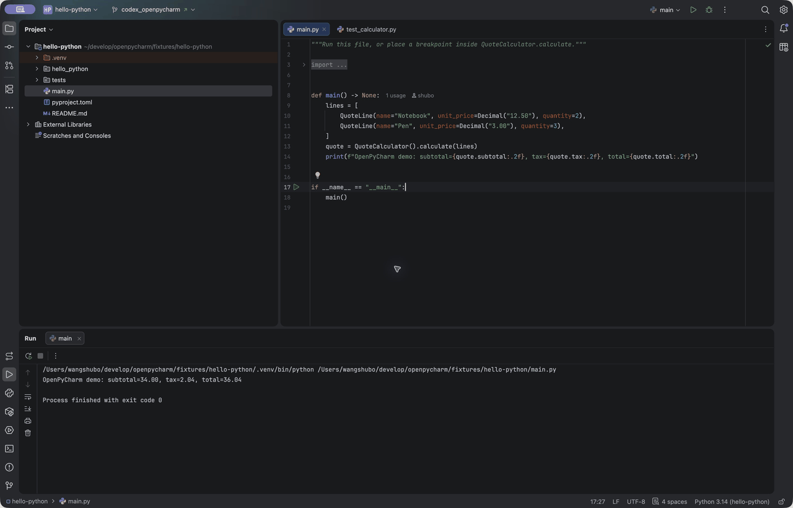

# OpenPyCharm

[简体中文](README.zh-CN.md)

An independent native Python IDE built on the open-source PyCharm and IntelliJ
Platform. The reference is the locally installed PyCharm **2026.1.4**. The
workbench, editor and Python PSI come from the same upstream version; this
repository owns the product identity, distribution, integration changes and
verification.

**Development is in progress. Full 1:1 parity is not yet verified.**

The **0.1.0-dev.3 preview** adds native Notebook and Database tools:

- Edit nbformat 4 `.ipynb` files in native Python cells. Run the selected local
  Python kernel with Run Cell, Shift+Enter and Run All; interrupt execution,
  inspect PNG/JPEG charts, static HTML/DataFrame tables, Markdown and tracebacks,
  then save and reopen the notebook. Opening a file does not execute code.
- Add database profiles, connect explicitly, browse metadata, run SQL in the
  native editor/console and inspect a read-only result grid. Transaction and
  cancellation controls and cached schema/table/column completion are included.
  Click **Refresh tables** for completion metadata; snapshots expire after five
  minutes, and ordinary SELECT queries do not refresh them.
- Retain native `.http` requests/Services responses and the independent Django,
  Flask and FastAPI generators and Run/Debug configurations from dev.2.
  Framework dependency installation remains optional and off by default.

Notebook execution requires a trusted project and user-installed dependencies in
its selected local Python. Remote kernels, widgets and notebook debugging are
not implemented. Database result editing/export and full SQL dialect semantics
are not implemented; PostgreSQL and MySQL/MariaDB drivers are bundled, but real
network connections remain unverified. Framework template/ORM intelligence and
broader navigation remain incomplete. See [installation](docs/installation.md)
and the [acceptance matrix](docs/acceptance.md).

The final macOS installation passed Python Run/unittest/two-breakpoint Debug,
local Notebook execution and rich outputs/save/reopen, and SQLite queries plus
keyboard table/column completion. The installers come from source `9a243e6` and
[dual-platform CI 43565932969](https://github.com/shubolab/openpycharm/actions/runs/43565932969).
Windows passed native API Notebook save/undo/reopen, local-kernel and
install/startup/uninstall checks; physical keyboard-and-mouse workflows remain
unverified there.

Preview: [v0.1.0-dev.3](https://github.com/shubolab/openpycharm/releases/tag/v0.1.0-dev.3).

| System | Installer |
| --- | --- |
| macOS Apple silicon | [DMG](https://github.com/shubolab/openpycharm/releases/download/v0.1.0-dev.3/OpenPyCharm-0.1.0-dev.3-macos-arm64.dmg) |
| Windows x64 | [EXE](https://github.com/shubolab/openpycharm/releases/download/v0.1.0-dev.3/OpenPyCharm-0.1.0-dev.3-windows-x64-setup.exe) |

See [installation](docs/installation.md), [checksums](https://github.com/shubolab/openpycharm/releases/download/v0.1.0-dev.3/SHA256SUMS.txt)
and [acceptance](docs/acceptance.md). The Mac app is ad-hoc signed and not
notarized; the Windows installer is unsigned.
[Previous preview: dev.2](https://github.com/shubolab/openpycharm/releases/tag/v0.1.0-dev.2).



Actual installed **0.1.0-dev.3**, **macOS 27.2 arm64**, local Python **3.14**:
Run, unittest, breakpoint debugging, Notebook chart/DataFrame output and a SQLite
query. This animation assembles real native app screenshots.
[Capture manifest](docs/demo/v0.1.0-dev.3/capture.json).
Each publishable release gets fresh installed-version captures and a manifest.

[Release verification](docs/verification/2026-11-14-dev3-release.md).

## Build

Python 3.10+ is required to assemble the product. The application includes its
Java runtime; select a local Python interpreter for your Python projects.
Keep at least 20 GiB free in addition to build space.

```sh
python3 -m pip install -r requirements-build.txt
python3 -m unittest discover -s tests -v
python3 scripts/provision_http_compiler.py
python3 scripts/provision_database_drivers.py
python3 scripts/build.py --target macos-arm64
python3 scripts/launch.py --profile .state/development fixtures/hello-python
python3 scripts/installers.py --target macos-arm64 --version 0.1.0-dev.3 --product build/product/OpenPyCharm.app
```

Run the Python example's tests from its own directory:

```sh
cd fixtures/hello-python
python3 main.py
python3 -m unittest discover -s tests -v
```

On Windows use `python` and `--target windows-x64`; the product directory is
`build/product/OpenPyCharm`. The installer builder obtains an authenticated Inno
Setup compiler when needed. See [installation](docs/installation.md).

The SDK is downloaded from the pinned [official open-source release](https://github.com/JetBrains/intellij-community/releases/tag/pycharm/2026.1.4),
verified by size and SHA-256, and reused only after a complete tree check.
Installed commercial IDEs and their user data are read-only references, never
product inputs. Local IDE use has no IDE account, billing, subscription, trial
or upgrade-promotion flow. Git, GitHub, private-repository and user-selected
development-service authentication remain available.

## Verify

Open [hello-python](fixtures/hello-python) for the Python editing, navigation,
refactoring, Run, unittest and Debug example. Its command-line tests are separate
from desktop acceptance. [Reference observations](docs/reference/installed-pycharm.md)
and [architecture](docs/architecture.md) record the evidence boundaries.

Source modifications are Apache-2.0. Upstream and third-party notices are retained.
OpenPyCharm is independently maintained and is not a JetBrains product.
