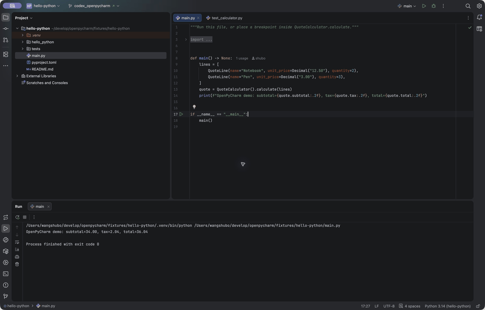

# OpenPyCharm

[English](README.md)

我们自己的原生 Python IDE，基于开源 PyCharm 和 IntelliJ Platform 构建，
以本机 **PyCharm 2026.1.4** 为对照。工作台、编辑器和 Python 代码分析沿用同版本
开源基础；本仓库负责独立产品身份、发行、集成修改和实际验收。

**当前正在开发，完整 1:1 对齐尚未完成。**

**0.1.0-dev.3 预览版**增加原生 Notebook 与数据库工具：

- 在原生 Python 单元中编辑 nbformat 4 格式的 `.ipynb`。使用所选本机 Python
  内核运行单元、Shift+Enter 或 Run All；可中断执行，查看 PNG/JPEG 图表、静态
  HTML/DataFrame 表格、Markdown 和错误堆栈，再保存并重新打开。打开文件不会执行代码。
- 添加连接配置，手动连接数据库，浏览元数据，在原生编辑器/控制台执行 SQL，并在
  只读结果表格中查看数据。提供事务、取消和基于缓存的 schema/表/列补全。
  补全前点击 **Refresh tables**；快照五分钟后过期，普通 SELECT 不会刷新它。
- 保留 dev.2 的原生 `.http`/Services 请求工具，以及独立实现的 Django、Flask、
  FastAPI 生成器与运行/调试配置。框架依赖安装仍可选，默认关闭。

Notebook 执行要求信任项目，并在所选本机 Python 中自行安装依赖；尚不支持远程内核、
widgets 和 Notebook 调试。数据库结果编辑/导出、完整 SQL 方言语义尚未实现；随包
携带 PostgreSQL 与 MySQL/MariaDB 驱动，但真实网络连接尚未验收。框架模板、ORM 智能
分析及更广的导航支持也仍不完整。详见[安装说明](docs/installation.md)与
[验收矩阵](docs/acceptance.md)。

最终 macOS 安装版已通过 Python 运行、unittest、两处断点调试，本地 Notebook
执行、富媒体输出及保存重开，以及 SQLite 查询和真实按键表/列补全。安装包来源为
`9a243e6`，对应[双平台 CI 43565932969](https://github.com/shubolab/openpycharm/actions/runs/43565932969)。
Windows 已通过原生 API Notebook 保存/撤销/重开、本地内核及安装/启动/卸载检查；
实际键盘、鼠标交互工作流仍待验收。

预览版：[v0.1.0-dev.3](https://github.com/shubolab/openpycharm/releases/tag/v0.1.0-dev.3)。

| 系统 | 安装包 |
| --- | --- |
| macOS Apple silicon | [DMG 下载](https://github.com/shubolab/openpycharm/releases/download/v0.1.0-dev.3/OpenPyCharm-0.1.0-dev.3-macos-arm64.dmg) |
| Windows x64 | [EXE 下载](https://github.com/shubolab/openpycharm/releases/download/v0.1.0-dev.3/OpenPyCharm-0.1.0-dev.3-windows-x64-setup.exe) |

见[安装说明](docs/installation.md)、[校验和](https://github.com/shubolab/openpycharm/releases/download/v0.1.0-dev.3/SHA256SUMS.txt)
与[验收矩阵](docs/acceptance.md)。Mac 应用使用临时签名且未公证，Windows 安装器未签名。
[上一预览版 dev.2](https://github.com/shubolab/openpycharm/releases/tag/v0.1.0-dev.2)保留下载。



实际安装版 **0.1.0-dev.3**，系统 **macOS 27.2 arm64**，本机 Python **3.14**。
展示运行、unittest、断点调试、Notebook 图表/DataFrame 与 SQLite 查询；动画由真实
原生应用截屏组装。[拍摄清单](docs/demo/v0.1.0-dev.3/capture.json)。每个可发版版本
都更新实际安装版截屏和对应清单。

## 本机构建

打包需要 Python 3.10 或更新版本，并在构建空间之外保留至少 20 GiB 可用磁盘。
应用内置 Java 运行时；Python 项目使用你选择的本机 Python 解释器。

```sh
python3 -m pip install -r requirements-build.txt
python3 -m unittest discover -s tests -v
python3 scripts/provision_http_compiler.py
python3 scripts/provision_database_drivers.py
python3 scripts/build.py --target macos-arm64
python3 scripts/launch.py --profile .state/development fixtures/hello-python
python3 scripts/installers.py --target macos-arm64 --version 0.1.0-dev.3 --product build/product/OpenPyCharm.app
```

在 Python 示例自己的目录运行其测试：

```sh
cd fixtures/hello-python
python3 main.py
python3 -m unittest discover -s tests -v
```

Windows 使用 `python` 和 `--target windows-x64`，产物目录为
`build/product/OpenPyCharm`。安装器构建器按需取得并验证 Inno Setup 编译器。
详见[安装说明](docs/installation.md)。

基础包来自[官方开源发行页](https://github.com/JetBrains/intellij-community/releases/tag/pycharm/2026.1.4)，
下载时核对大小和 SHA-256，复用缓存时核对完整文件树。已安装的商业 IDE 及其用户
数据只用于只读比对，不作为分发输入。本地 IDE 使用不包含 IDE 账号、计费、订阅、
试用和升级推广流程；Git、GitHub、私有仓库及用户选择的开发服务认证保留。

## 示例与验收

[hello-python](fixtures/hello-python) 提供补全、跨文件导航、重构、运行、unittest
和断点调试示例。命令行测试通过与桌面验收分开记录。参考版本和范围见
[本机观察记录](docs/reference/installed-pycharm.md)与[架构说明](docs/architecture.md)。

源码修改采用 Apache-2.0，保留上游及第三方声明。OpenPyCharm 由我们独立维护。
