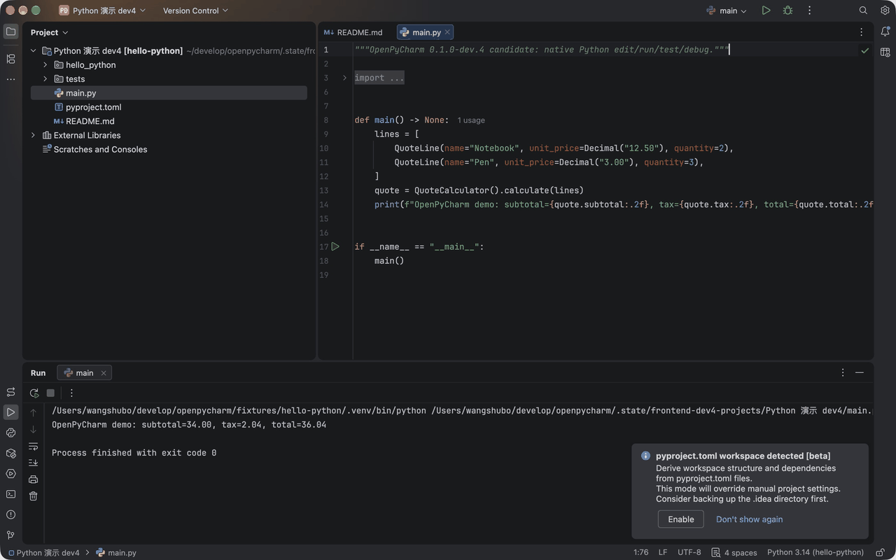

# OpenPyCharm

[English](README.md)

我们自己的原生 Python IDE，基于开源 PyCharm 和 IntelliJ Platform 构建，
以本机 **PyCharm 2026.1.4** 为对照。工作台、编辑器和 Python 代码分析沿用同版本
开源基础；本仓库负责独立产品身份、发行、集成修改和实际验收。

**当前正在开发，完整 1:1 对齐尚未完成。**

**0.1.0-dev.4 预览版**在 Python、Notebook、数据库、HTTP 与框架工具基础上，
新增原生 JavaScript 和 TypeScript 语言服务：

- 打开已信任的本地项目，使用原生补全、诊断和定义跳转。语言服务默认开启，
  可在 **Settings → Languages & Frameworks → JavaScript and TypeScript**
  中按项目关闭。
- 随包携带 Node.js **24.22.3**、TypeScript **6.0.3** 和
  typescript-language-server **6.1.0**，启动前核对完整固定文件。
  打开编辑器不下载运行时、不安装依赖，分析状态写入独立的 OpenPyCharm 缓存目录。
- 保留原生 `.ipynb` 单元和本地内核、SQL 连接/控制台与缓存元数据补全、
  `.http`/Services 请求工具，以及 Django/Flask/FastAPI 生成器与运行/调试配置。

本机实际安装的 dev.4 DMG 候选已完成 Python 编辑、运行、unittest（9 个方法/
20 项）、断点/单步/求值/继续、原生补全和跨文件 Rename/Undo。JavaScript/TypeScript
实测覆盖成员补全、类型诊断、定义跳转，以及含中文、emoji 的未保存文本补全。
正常关闭项目后，三个自有 Node 进程均已退出；安装版产品树未变，严格签名核对通过。

[CI 43608150941](https://github.com/shubolab/openpycharm/actions/runs/43608150941)
已在源码 `63921a4` 上双平台通过，包括前端 JVM、完整运行时、原生产品和安装器
检查。完整下载的 ZIP 和安装器已独立核对摘要；CI DMG 也已实际复制安装、启动，
签名与产品树保持不变。其 171 项生产输入和五个插件 JAR 与本机桌面实测版本一致。
详见[dev.4 发行验收](docs/verification/2026-11-14-dev4-release.md)。

HTML/CSS、JavaScript/TypeScript 专用语法 PSI 与重构、前端框架智能分析和完整
PyCharm 对齐仍未完成。框架模板/ORM、网络数据库、Windows 实际键鼠桌面及进程
所有者意外崩溃后的清理仍待实现或验收。Notebook 远程内核、widgets、调试和数据库
结果编辑/导出尚未实现。详见[安装说明](docs/installation.md)与[验收矩阵](docs/acceptance.md)。

## 已发布预览版

[v0.1.0-dev.4](https://github.com/shubolab/openpycharm/releases/tag/v0.1.0-dev.4)，源码 `63921a4`，
对应[双平台 CI 43608150941](https://github.com/shubolab/openpycharm/actions/runs/43608150941)。

| 系统 | 安装包 |
| --- | --- |
| macOS Apple silicon | [DMG 下载](https://github.com/shubolab/openpycharm/releases/download/v0.1.0-dev.4/OpenPyCharm-0.1.0-dev.4-macos-arm64.dmg) |
| Windows x64 | [EXE 下载](https://github.com/shubolab/openpycharm/releases/download/v0.1.0-dev.4/OpenPyCharm-0.1.0-dev.4-windows-x64-setup.exe) |

见[安装说明](docs/installation.md)、[校验和](https://github.com/shubolab/openpycharm/releases/download/v0.1.0-dev.4/SHA256SUMS.txt)
与[发行验收](docs/verification/2026-11-14-dev4-release.md)。Mac 应用使用临时签名且未
公证，Windows 安装器未签名。[上一预览版 dev.3](https://github.com/shubolab/openpycharm/releases/tag/v0.1.0-dev.3)保留下载。



实际安装版 **0.1.0-dev.4**，系统 **macOS 27.2 arm64**，Python **3.14.0**。
六帧展示 Python 运行、unittest、断点/求值、跨文件 Rename 后测试、TypeScript 补全/
诊断和 JavaScript 未保存补全。动画来自**本机 DMG 候选**的真实原生截屏，源码
`88387c3`，DMG SHA-256：`8b849bc6db67e929c8dff25ed32f79b0bb1d420c89487b6d85c0e34c8545dd64`。
拍摄来源与 CI 安装器验收分别记录。[拍摄清单](docs/demo/v0.1.0-dev.4/capture.json)。
每个可发版版本都更新实际安装版演示和清单。
[dev.3 历史演示](docs/demo/v0.1.0-dev.3/openpycharm-native.gif)保留。

## 构建 dev.4 预览版

需要 Python 3.10 或更新版本，并在构建空间之外保留至少 20 GiB 可用磁盘。应用内置
Java；Python 项目使用你选择的本机解释器。普通构建命令仍默认 dev.3，组装五插件
预览版须显式指定版本和前端运行时收据：

```sh
python3 -m pip install -r requirements-build.txt
python3 -m unittest discover -s tests -v
python3 scripts/bootstrap.py --target macos-arm64
python3 scripts/provision_http_compiler.py
python3 scripts/provision_database_drivers.py
python3 scripts/provision_frontend_tools.py --target macos-arm64
python3 scripts/package.py --target macos-arm64 --version 0.1.0-dev.4 --output build/dev4/OpenPyCharm.app --frontend-runtime-receipt /absolute/path/from-provision/frontend-tools.json
python3 scripts/launch.py --app build/dev4/OpenPyCharm.app --profile .state/development fixtures/hello-python
python3 scripts/installers.py --target macos-arm64 --version 0.1.0-dev.4 --product build/dev4/OpenPyCharm.app
```

将收据占位路径替换为 provision 输出的 `receipt`。准备工具是显式的构建时网络动作，
普通编辑器打开只使用随包工具。每次组装选择新的输出路径。
Windows 使用 `python`、`--target windows-x64` 和 `build/dev4/OpenPyCharm`；安装器
构建器按需取得并验证 Inno Setup 编译器。

基础包来自[官方开源发行页](https://github.com/JetBrains/intellij-community/releases/tag/pycharm/2026.1.4)，
下载时核对大小和 SHA-256，复用缓存时核对完整文件树。已安装的商业 IDE 及其数据
仅用于只读比对。本地 IDE 使用不包含 IDE 账号、计费、订阅、试用和升级流程；保留
Git、GitHub、私有仓库及用户选择的服务认证。源码修改采用 Apache-2.0，保留上游及
第三方声明。OpenPyCharm 由我们独立维护。

## 示例与验收

[hello-python](fixtures/hello-python) 提供 Python 编辑、导航、重构、运行、unittest
和断点调试示例。在示例自己的目录另行运行命令行检查：

```sh
cd fixtures/hello-python
python3 main.py
python3 -m unittest discover -s tests -v
```

命令行、原生 API 与安装版桌面验收分别记录。参考范围见
[本机观察记录](docs/reference/installed-pycharm.md)与[架构说明](docs/architecture.md)。
