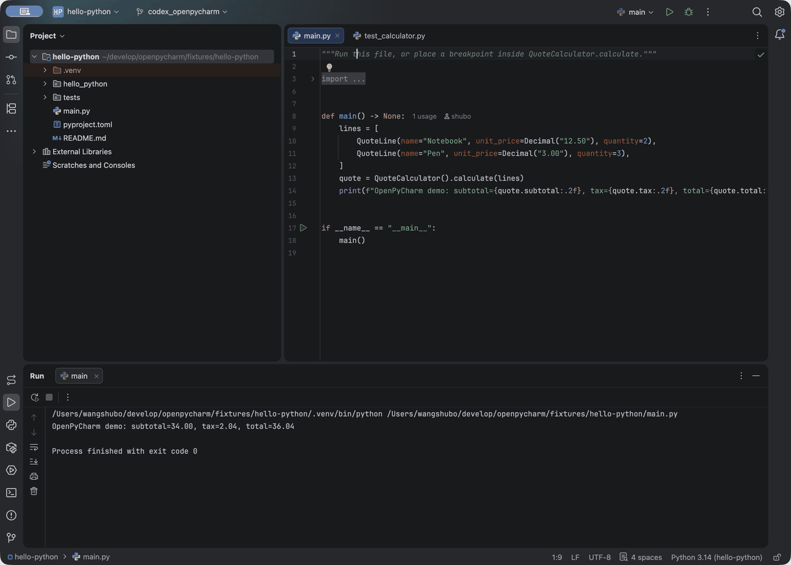

# Native workflow demo

Recorded **OpenPyCharm 0.1.0-dev.2**, based on **PC-261.26222.68 (2026.1.4)**,
on **macOS 27.2 arm64**, using **Python 3.14.0**, on 2026-11-14.

The GIF combines real native app captures: successful Run, unittest results
(20 items including subtests, 9 test methods), a FastAPI request breakpoint with
`app.title` evaluated to `FastAPI`, and three HTTP responses including a Chinese
and emoji JSON echo. It is an animated sequence of captured states. Original
screenshots and hashes are retained in the [versioned capture manifest](v0.1.0-dev.2/capture.json).

This recording comes from the dev.2 CI DMG's actual installed macOS app.
The [capture manifest](capture.json) binds its installer hash and production source
commit. Native Run/unittest/FastAPI Debug/HTTP completed successfully; restored
Markdown also rendered correctly. The installed tree and signature still matched
after the workflows, with zero session ERROR/SEVERE records. See the
[installed desktop receipt](../verification/dev2-installed-desktop-20261114.json).
Every publishable version must update
the README demo from that version's actual installed app and refresh the version,
system and capture manifest. Source changes that materially alter the demonstrated
workflow require new captures.

Update `capture.json` with the actual version, OS, Python and capture date before
assembling a new recording. The recipe preserves that reviewed metadata rather
than guessing it from the current development machine. Rebuild the GIF with
`python3 scripts/make-demo.py`. The versioned recipe is
`python3 scripts/make-demo.py --directory docs/demo/v0.1.0-dev.2`.

[Historical dev.1 recording](v0.1.0-dev.1/README.md) is retained separately.
