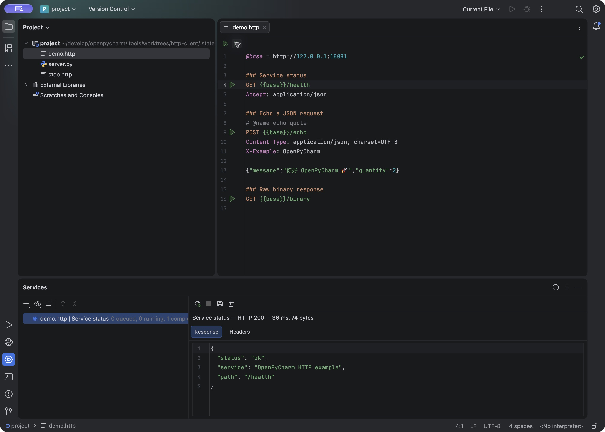
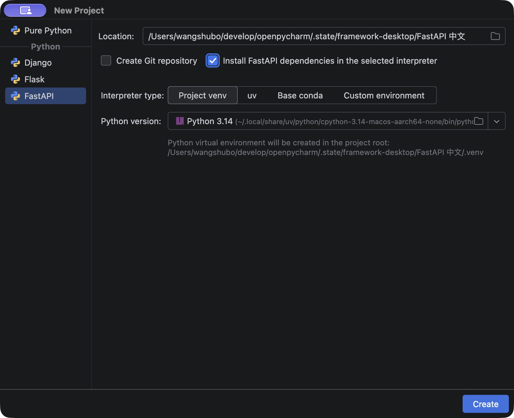

# dev.2 development observations

These are actual native screenshots from the separately built HTTP candidate
`6f9ae45`, version `0.1.0-dev.2`, on macOS 27.2 arm64. They are development
evidence, separate from the published dev.1 installed-app GIF.

The desktop checks also saved the exact 16-byte binary response through the
native dialog and cancelled a running streaming response with Stop All.
The app tree remained unchanged and strict signature verification passed.
[Structured record](../../verification/http-desktop-20261114.json).

Before publishing dev.2, capture the actual final installed build and refresh the
main README GIF and manifest. This checkpoint does not claim that the complete
framework-integrated build, Windows desktop workflow or final installer passed.

The combined candidate at `80cea80` also passed actual FastAPI creation using
native Project venv / Python 3.14 in a path containing Chinese and a space,
opted-in dependency installation, Run returning HTTP 200 at `/`, and native Stop
with a graceful exit. Its app tree and strict signature remained unchanged.
[Framework desktop record](../../verification/framework-desktop-20261114.json).

That candidate's generated example still contained an internal probe marker.
The subsequent template cleanup removes it; new-template UI/debug and final
installed-build acceptance remain open. The raw running-console checkpoint is
retained in [fastapi-run.jpg](fastapi-run.jpg); its `/health` 404 came from an
acceptance request to a route not declared by that template, followed by the
successful request to its declared `/` route.
