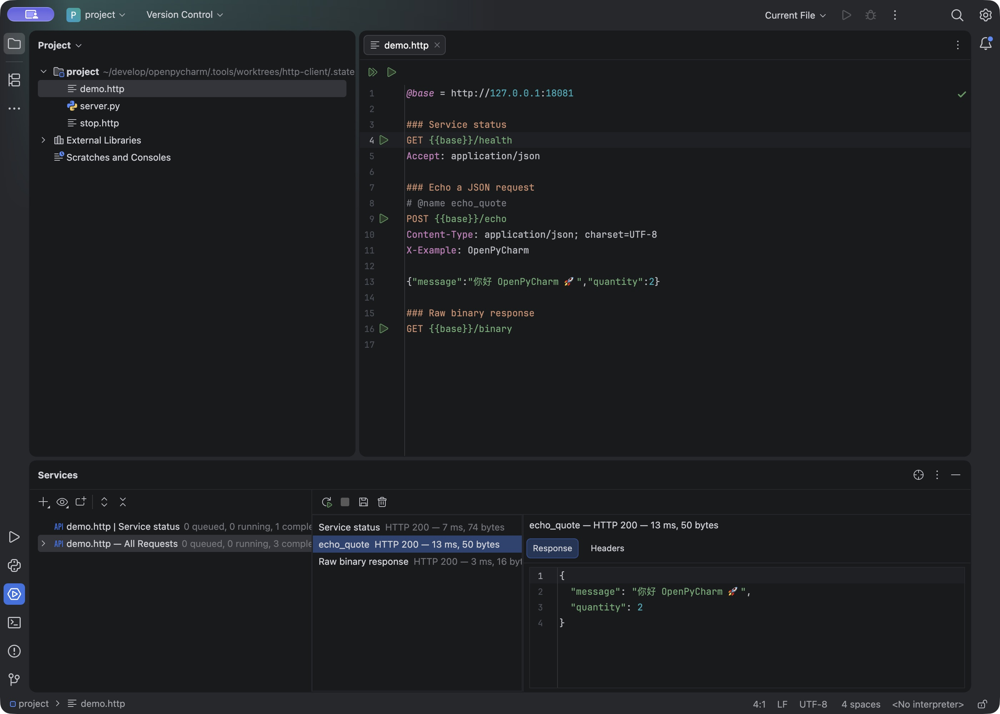

# dev.2 development observations

These are actual native screenshots from the separately built HTTP candidate
`6f9ae45`, version `0.1.0-dev.2`, on macOS 27.2 arm64. They are development
evidence, separate from the published dev.1 installed-app GIF.

The desktop checks also saved the exact 16-byte binary response through the
native dialog and cancelled a running streaming response with Stop All.
The app tree remained unchanged and strict signature verification passed.
[Structured record](../../verification/http-desktop-20261114.json).

Before publishing dev.2, capture the actual final installed build and refresh the
main README GIF and manifest. This checkpoint does not claim that the complete
framework-integrated build, Windows desktop workflow or final installer passed.
