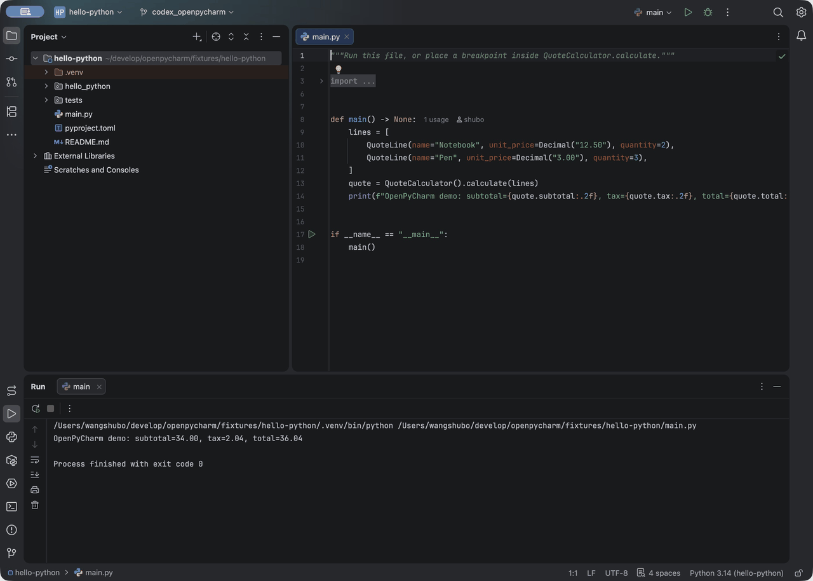

Historical dev.1 recording. [Current demo](../README.md).

# Native workflow demo

Recorded **OpenPyCharm 0.1.0-dev.1**, based on **PC-261.26222.68 (2026.1.4)**,
on **macOS 27.2 arm64**, using **Python 3.14.0**, on 2026-11-14.

The GIF combines real native app captures: successful Run, unittest results
(20 items including subtests, 9 test methods), breakpoint/stack/locals/expression
evaluation, and Step Over. It is an animated sequence of captured states, not a
mock interface. Original screenshot files and hashes are retained alongside it.

This recording comes from the published preview’s actual installed macOS app.
The [capture manifest](capture.json) binds its installer hash and production source
commit. Native Run/unittest/Debug completed successfully; the installed tree and
signature still matched after the workflows. Every publishable version must update
the README demo from that version's actual installed app and refresh the version,
system and capture manifest. Source changes that materially alter the demonstrated
workflow require new captures.

Update `capture.json` with the actual version, OS, Python and capture date before
assembling a new recording. The recipe preserves that reviewed metadata rather
than guessing it from the current development machine. Rebuild the GIF with
`python3 scripts/make-demo.py --directory docs/demo/v0.1.0-dev.1`.
